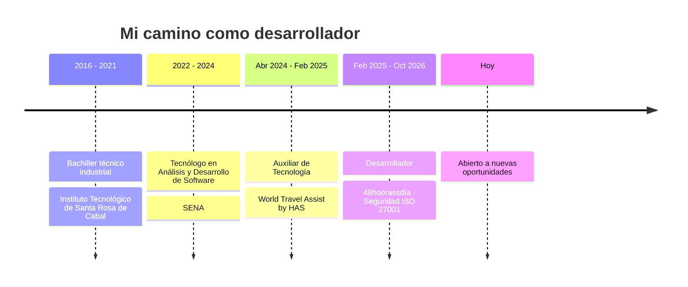

<!-- ============================================================= -->
<!--  README · Alejandro Sánchez Loaiza                              -->
<!-- ============================================================= -->

<div align="center">



<a href="https://github.com/asanchezloaiza274-cell">
  
</a>

<br/><br/>


<br/><br/>

<a href="mailto:asanchezloaiza274@gmail.com"></a>
<a href="https://www.linkedin.com/in/alejandro-s%C3%A1nchez-loaiza-dev"></a>
<a href="https://github.com/asanchezloaiza274-cell"></a>

</div>

<br/>


## ⚡ `sobre_mi.py`

<table>
<tr>
<td width="58%" valign="top">

```python
class Alejandro:
    def __init__(self):
        self.rol        = "Desarrollador Web Full Stack"
        self.titulo     = "Tecnólogo en ADSO · SENA"
        self.ubicacion  = "Risaralda, Colombia 🇨🇴"
        self.stack      = ["Django", "React", "Tailwind", "PWA"]
        self.seguridad  = "ISO 27001"
        self.mantra     = "Código limpio, sistemas seguros"

    def hoy(self):
        return [
            "🔭 Construyendo apps con Django + React",
            "🔐 Aplicando seguridad de la información",
            "📱 Creando Progressive Web Apps",
            "🌱 Aprendiendo algo nuevo cada día",
        ]
```

</td>
<td width="42%" valign="top" align="center">

<br/>

**Desarrollador apasionado por crear aplicaciones modernas, seguras y eficientes.**

Responsable, proactivo y comprometido, con gran capacidad para trabajar en equipo y adaptarme a nuevos retos.

<br/>


</td>
</tr>
</table>

<br/>

## 🧰 Stack tecnológico

<div align="center">

<table>
<tr>
<td align="center" width="33%">
<h4>⚙️ Backend</h4>

</td>
<td align="center" width="33%">
<h4>🎨 Frontend</h4>

</td>
<td align="center" width="33%">
<h4>🛠️ Herramientas</h4>

</td>
</tr>
</table>


</div>

<br/>

## 🛤️ Trayectoria



<details open>
<summary><b>🧑‍💻 Desarrollador · 48hoorassdía</b> &nbsp;<code>Feb 2025 – Oct 2026</code></summary>
<br/>

- Desarrollo y mantenimiento de aplicaciones web con **Django** y **React**.
- Responsable de la **seguridad de la información** de las plataformas, alineadas con la norma **ISO 27001**.
- Participación ampliada en el desarrollo y mantenimiento del producto.

</details>

<details>
<summary><b>🧩 Auxiliar de Tecnología · World Travel Assist by HAS</b> &nbsp;<code>Abr 2024 – Feb 2025</code></summary>
<br/>

- Apoyo en el desarrollo y mantenimiento de aplicaciones web con **Django**.
- Interfaces responsivas con **Tailwind CSS** a partir de diseños definidos.
- Funcionalidades básicas de **PWA**.
- Componentes en **React** para mejorar la interactividad del frontend.
- Control de versiones y trabajo colaborativo con **Git**.

</details>

<details>
<summary><b>🎓 Formación académica</b></summary>
<br/>

| Institución | Título | Periodo |
|:--|:--|:--:|
| **SENA** | Tecnólogo en Análisis y Desarrollo de Software | 2022 – 2024 |
| **Instituto Tecnológico de Santa Rosa de Cabal** | Bachiller técnico industrial | 2016 – 2021 |

</details>

<br/>

## 🚀 Proyectos

<table>
<tr>
<td width="50%" valign="top">

### 💼 [portfolio](https://github.com/asanchezloaiza274-cell/portfolio)
Mi portafolio web personal.


</td>
<td width="50%" valign="top">

### 💬 [chat](https://github.com/asanchezloaiza274-cell/chat)
Aplicación de chat.


</td>
</tr>
</table>

<br/>

## 📊 Estadísticas

<div align="center">


<br/>


<br/>


</div>

<br/>

## 🎯 Roadmap

| Estado | Objetivo |
|:--:|:--|
| ✅ | Graduarme como Tecnólogo en Análisis y Desarrollo de Software |
| ✅ | Conseguir mi primera experiencia profesional como desarrollador |
| ✅ | Integrar seguridad de la información (ISO 27001) en mi día a día |
| 🔄 | Profundizar en arquitectura de software y buenas prácticas |
| 🔄 | Crecer como desarrollador Full Stack |
| 🔜 | Contribuir a proyectos open source |

<br/>


<div align="center">

## 🤝 ¿Construimos algo juntos?

*¿Tienes un proyecto, una oportunidad o simplemente quieres charlar de tecnología?*

<a href="mailto:asanchezloaiza274@gmail.com"></a>
<a href="https://www.linkedin.com/in/alejandro-s%C3%A1nchez-loaiza-dev"></a>

<br/><br/>


<br/>


</div>
